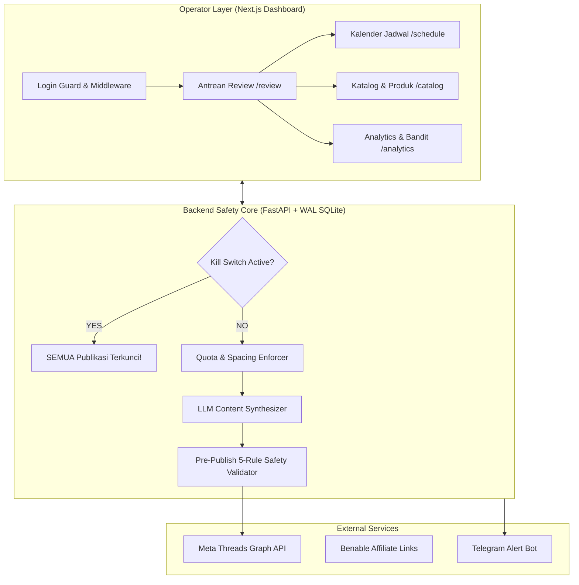
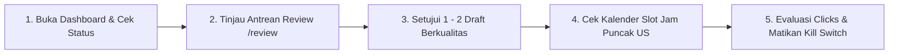

# 📘 BUKU PANDUAN OPERATOR & SKENARIO PENGUJIAN LENGKAP (A - Z)
**Threads Affiliate Semi-Autonomous Content Engine (US Audience / Benable)**

---

## 📑 DAFTAR ISI
1. [BAB 1: Filosofi & Arsitektur Sistem (Prinsip Fail-Closed)](#bab-1-filosofi--arsitektur-sistem-prinsip-fail-closed)
2. [BAB 2: Prasyarat Lingkungan & Konfigurasi (.env)](#bab-2-prasyarat-lingkungan--konfigurasi-env)
3. [BAB 3: Cara Menjalankan & Memantau Server](#bab-3-cara-menjalankan--memantau-server)
4. [BAB 4: Panduan Modul & Fitur Dashboard (A - Z)](#bab-4-panduan-modul--fitur-dashboard-a---z)
   - 4.1. [Otentikasi & Keamanan Sesi](#41-otentikasi--keamanan-sesi)
   - 4.2. [Tombol Darurat (Kill Switch & Health Status)](#42-tombol-darurat-kill-switch--health-status)
   - 4.3. [Antrean Review Konten (/review)](#43-antrean-review-konten-review)
   - 4.4. [Katalog Konten & Impor Benable (/catalog)](#44-katalog-konten--impor-benable-catalog)
   - 4.5. [Jadwal Kalender & Manajemen Slot (/schedule)](#45-jadwal-kalender--manajemen-slot-schedule)
   - 4.6. [Analitik, Clicks, & Eksperimen Bandit (/analytics)](#46-analitik-clicks--eksperimen-bandit-analytics)
   - 4.7. [Asisten Komentar Bernilai Tinggi F10 (/comments)](#47-asisten-komentar-bernilai-tinggi-f10-comments)
   - 4.8. [Pengaturan, Batasan Kuota, & Audit Trail (/settings)](#48-pengaturan-batasan-kuota--audit-trail-settings)
5. [BAB 5: Skenario Pengujian Pra-Produksi (Pre-Flight Test Suite)](#bab-5-skenario-pengujian-pra-produksi-pre-flight-test-suite)
   - Skenario 1: Keamanan Otentikasi & Brute Force Lockout
   - Skenario 2: Uji Respon Kill Switch (Emergency Stop $\le 5$ Detik)
   - Skenario 3: Impor CSV Produk Benable & Deteksi Duplikasi
   - Skenario 4: Mesin Pembuat Draft & Validator Kepatuhan (FTC/Meta)
   - Skenario 5: Penjadwalan Kalender & Interval Anti-Spam (Jarak $\ge 120$ Menit)
   - Skenario 6: Simulasi Eksekusi Penerbitan (Dry-Run vs Real API)
   - Skenario 7: Asisten Komentar F10 & Batasan Kuota Ketat
   - Skenario 8: Chaos Engineering & Crash Recovery (Zero Duplicate Post)
   - Skenario 9: Audit Trail Tamper-Evident Verification
6. [BAB 6: Standard Operating Procedure (SOP) Harian Operator](#bab-6-standard-operating-procedure-sop-harian-operator)

---

## BAB 1: Filosofi & Arsitektur Sistem (Prinsip Fail-Closed)

Sistem ini dirancang khusus untuk menjalankan operasional konten afiliasi di Meta Threads dengan target audiens Amerika Serikat (US Audience) melalui platform kurasi **Benable**.



### 4 Pilar Keselamatan Mutlak (Safety Guardrails)
1. **K-1 (Human-in-the-Loop):** Tidak ada konten yang dipublikasikan ke Threads tanpa persetujuan eksplisit operator manusia melalui antrean review di dashboard atau Telegram.
2. **K-2 (Immutable Compliance):** Setiap postingan wajib memuat tag kepatuhan FTC (`#ad` atau `Earns commission`), lolos filter kata terlarang (no engagement bait, no overpromising), dan menggunakan URL Benable yang valid.
3. **K-3 (Fail-Closed Kill Switch):** Jika terjadi kegagalan jaringan, error rate limit (HTTP 429), masa berlaku token habis, atau sistem di-restart, status default sistem selalu **TERKUNCI (PAUSED/KILL SWITCH ON)** sampai operator sengaja membukanya.
4. **K-4 (Single Active Lock & Zero Duplicate Guarantee):** Proses penjadwalan menggunakan kunci database transaksional (SQLite WAL mode dengan `BEGIN IMMEDIATE`), memastikan tidak akan pernah ada postingan ganda akibat benturan konkurensi atau restart worker.

---

## BAB 2: Prasyarat Lingkungan & Konfigurasi (.env)

Konfigurasi sistem diatur terpusat pada file `.env` di direktori utama `threads-affiliate/.env`.

### Contoh Variabel Lingkungan Utama:

```bash
# ---------------------------------------------------------------------------
# Core Server & Database
# ---------------------------------------------------------------------------
ENVIRONMENT=production
DEBUG=false
SECRET_KEY=ganti-dengan-kunci-acak-minimal-32-karakter-keamanan-tinggi
DATABASE_URL=sqlite+aiosqlite:////Volumes/Backup/03_VIBE_CODING/Threads Afilliate/threads-affiliate/data/app.db

# ---------------------------------------------------------------------------
# Kredensial Administrator Dashboard
# ---------------------------------------------------------------------------
ADMIN_USERNAME=admin
# Password default: admin123 (Ubah segera untuk deployment publik!)
ADMIN_PASSWORD_HASH=$2b$12$e868a2xN8r1e15gO6lKqE.n1UuYlX5i2G0C4FfV7oJ2R5Qx/Z1E0u

# ---------------------------------------------------------------------------
# Meta Threads Graph API (US Audience Target)
# ---------------------------------------------------------------------------
THREADS_APP_ID=your_threads_app_id
THREADS_APP_SECRET=your_threads_app_secret
THREADS_ACCESS_TOKEN=your_long_lived_threads_token
THREADS_USER_ID=your_threads_user_id

# ---------------------------------------------------------------------------
# AI LLM Provider (Google Gemini / Anthropic / OpenAI)
# ---------------------------------------------------------------------------
LLM_PROVIDER=gemini
GEMINI_API_KEY=your_gemini_api_key_here
LLM_MODEL=gemini-1.5-pro

# ---------------------------------------------------------------------------
# Telegram Bot Emergency & Notification
# ---------------------------------------------------------------------------
TELEGRAM_BOT_TOKEN=your_telegram_bot_token
TELEGRAM_OPERATOR_CHAT_ID=your_chat_id
```

> [!IMPORTANT]
> Pastikan `DATABASE_URL` menggunakan path absolut pada mesin host Anda agar worker daemon maupun Uvicorn selalu mengakses file database SQLite WAL yang sama.

---

## BAB 3: Cara Menjalankan & Memantau Server

Kedua layanan dapat dijalankan secara terpisah di terminal macOS/Linux:

### 1. Menjalankan Backend API (FastAPI)
```bash
cd "threads-affiliate/backend"
# Menggunakan virtual environment uv Python 3.12
.venv/bin/uvicorn app.main:app --host 127.0.0.1 --port 8000
```
- Endpoint Dokumentasi API Interaktif: `http://127.0.0.1:8000/docs`
- Endpoint Health Status: `http://127.0.0.1:8000/health`

### 2. Menjalankan Frontend Dashboard (Next.js 14)
```bash
cd "threads-affiliate/frontend"
npm run dev -- -p 3000
```
- Dashboard UI: `http://localhost:3000`

---

## BAB 4: Panduan Modul & Fitur Dashboard (A - Z)

### 4.1. Otentikasi & Keamanan Sesi
- **Rute:** `/login`
- **Mekanisme:** Otentikasi menggunakan password hash bcrypt dengan signed session cookie (HttpOnly, SameSite=Lax).
- **Perlindungan Brute-Force:** Jika terjadi **5 kali kegagalan berturut-turut**, IP klien akan dikunci selama **15 menit**.
- **Next.js Middleware:** Semua halaman privat dilindungi oleh [`middleware.ts`](file:///Volumes/Backup/03_VIBE_CODING/Threads%20Afilliate/threads-affiliate/frontend/src/middleware.ts). Jika sesi belum ada, pengguna otomatis diarahkan ke `/login`.
- **Tombol Keluar:** Terletak di sudut kanan atas Header, menghapus cookie sesi dan membersihkan state.

---

### 4.2. Tombol Darurat (Kill Switch & Health Status)
- **Letak:** Bar navigasi atas (Header) di semua halaman.
- **Indikator Status:**
  - 🔴 **Sistem Dijeda (Kill Switch ON):** Seluruh proses penerbitan otomatis maupun terjadwal dibekukan total.
  - 🟢 **Sistem Aktif (Kill Switch OFF):** Sistem siap mempublikasikan postingan sesuai jadwal.
  - 🟡 **Degraded:** Terdapat anomali token Threads, latensi tinggi, atau koneksi bermasalah.
- **Cara Mengubah Status:**
  1. Klik tombol **"Kill Switch"** di Header.
  2. Dialog konfirmasi modal akan muncul menampilkan alasan status saat ini.
  3. Masukkan catatan/alasan perubahan lalu konfirmasi toggle.
  4. Perubahan langsung tercatat di Audit Log dan efektif dalam waktu $< 5$ detik.

---

### 4.3. Antrean Review Konten (`/review`)
Pusat kendali operator untuk memeriksa setiap draft konten sebelum dijadwalkan:

1. **Kartu Draft (Draft Card):**
   - Menampilkan teks postingan, niche, gaya konten (*curator, quick review, tips, pros & cons, question*), produk yang direkomendasikan, dan tautan Benable.
2. **Validator Kepatuhan Real-Time (5 Checklist):**
   - ✅ **Banned Words:** Memastikan tidak ada kata terlarang (misal: *follow for follow, dm me, guaranteed money, link in bio bait*).
   - ✅ **FTC Disclosure:** Memastikan kehadiran penanda afiliasi legal (`#ad`, `Earns commission`, atau `#sponsored`).
   - ✅ **Character Limit:** Maksimum 500 karakter sesuai batasan Meta Threads.
   - ✅ **URL Benable Valid:** Tautan menggunakan domain terdaftar dan format aman.
   - ✅ **Anti-Spam Spacing:** Memastikan jeda waktu antar postingan $\ge 120$ menit.
3. **Aksi Operator:**
   - **Setujui (Approve):** Memindahkan draft ke status `approved` dan menempatkannya ke antrean slot kalender berikutnya.
   - **Edit Inline:** Mengubah kata-kata draft langsung di browser. Validator akan mengecek ulang isi teks secara real-time saat Anda mengetik.
   - **Tolak (Reject):** Membatalkan draft dengan menyertakan alasan (misal: *rekomendasi tidak relevan, gaya bahasa kaku*).

---

### 4.4. Katalog Konten & Impor Benable (`/catalog`)
Modul manajemen aset konten yang menjadi bahan bakar mesin AI:

- **Tab Niche:** Pengaturan vertikal konten terfokus (misal: *Minimalist Desk Setup, Home Barista, Productivity Gear*).
- **Tab Style:** Pengaturan 5 formula struktur postingan.
- **Tab Persona:** Menentukan gaya kepribadian dan template disclosure wajib (`US Tech Enthusiast Curator`).
- **Tab Produk & Impor Benable:**
  - Mengelola daftar produk rekomendasi.
  - **Batch Import CSV Benable:** Unggah file CSV ekspor dari Benable untuk memperbarui database produk. Terdapat fitur **Preview** sebelum data benar-benar disimpan ke database.

---

### 4.5. Jadwal Kalender & Manajemen Slot (`/schedule`)
Visualisasi jadwal postingan harian dan mingguan:

- **Zona Waktu:** Standar **US/Eastern (EST/EDT)** untuk mencocokkan jam aktif puncak audiens Amerika:
  - Pagi: `07:00 - 08:30 EST`
  - Istirahat Siang: `12:00 - 13:30 EST`
  - Pulang Kerja: `17:30 - 19:00 EST`
  - Santai Malam: `21:00 - 22:30 EST`
- **Slot Reschedule Modal:** Memindahkan draft ke tanggal atau jam berbeda dengan pemeriksaan otomatis interval keamanan anti-spam.

---

### 4.6. Analitik, Clicks, & Eksperimen Bandit (`/analytics`)
Modul data intelijen untuk memaksimalkan rasio konversi:

- **Tab Performa:** Metrik postingan yang telah terbit (Views, Likes, Replies, Reposts) yang diukur pada interval usia postingan: 2 jam, 6 jam, 24 jam, dan 72 jam.
- **Tab Benable Clicks:** Pencatatan klik tautan afiliasi Benable, memetakan produk mana yang paling banyak diklik oleh pembaca.
- **Tab Eksperimen (Multi-Armed Bandit):**
  - Menguji performa antar Niche atau Style secara saintifik (A/B testing).
  - Algoritma menghitung arm pemenang berdasarkan *median engagement rate* dan jumlah konversi klik.
- **Tab Laporan Mingguan:** Ringkasan performa 7 hari terakhir beserta saran aksi perbaikan otomatis dari sistem.

---

### 4.7. Asisten Komentar Bernilai Tinggi F10 (`/comments`)
Fitur strategi pertumbuhan organik dengan meninggalkan komentar bernilai tinggi di postingan Threads pihak lain:

1. Masukkan URL postingan Threads target yang relevan dengan niche produk Anda.
2. AI menganalisis konteks postingan target dan menghasilkan 3 opsi komentar yang sopan, solutif, dan natural tanpa terkesan spam.
3. **Batas Kuota:** Sistem membatasi maksimal 10 reply per hari guna melindungi reputasi akun dari deteksi bot Meta.
4. Pilih **"Salin ke Clipboard"** untuk menempelkan secara manual di aplikasi Threads, atau publikasikan via API.

---

### 4.8. Pengaturan, Batasan Kuota, & Audit Trail (`/settings`)
- **Status Akun Threads:** Pemantauan masa aktif token otentikasi Meta.
- **Batasan Operasional:** Konfigurasi batas jumlah post harian bertahap (Minggu 1: 1 post/hari $\rightarrow$ Minggu 2: 2 post/hari $\rightarrow$ Minggu 3: 3 post/hari).
- **Log Insiden:** Daftar kegagalan sistem atau penolakan API beserta penjelasannya.
- **Audit Trail:** Catatan forensik setiap tindakan (login, edit, approve, kill switch toggle, update produk) yang tersimpan secara *append-only*.

---

## BAB 5: Skenario Pengujian Pra-Produksi (Pre-Flight Test Suite)

Lakukan 9 skenario uji coba berikut secara berurutan sebelum menyambungkan sistem ke akun Threads produksi:

### Skenario 1: Keamanan Otentikasi & Brute Force Lockout
| Langkah | Tindakan yang Diuji | Hasil yang Diharapkan |
| :--- | :--- | :--- |
| 1.1 | Buka `http://localhost:3000/analytics` di jendela Incognito tanpa login. | Otomatis di-redirect ke `/login?from=%2Fanalytics`. |
| 1.2 | Masukkan username `admin` dan password salah `wrongpass` sebanyak 5 kali. | Pada percobaan ke-5, server menolak dengan HTTP 429: *"Too many failed login attempts. Account locked for 15 minutes."* |
| 1.3 | Masukkan username `admin` dan password benar `admin123`. | Berhasil masuk ke `/review`, cookie sesi HttpOnly aktif. |

---

### Skenario 2: Uji Respon Kill Switch (Emergency Stop $\le 5$ Detik)
| Langkah | Tindakan yang Diuji | Hasil yang Diharapkan |
| :--- | :--- | :--- |
| 2.1 | Periksa Header status, klik **Kill Switch**. | Modal konfirmasi muncul dengan opsi memasukkan alasan. |
| 2.2 | Konfirmasi toggle ke status **OFF** (Sistem Aktif). | Header berubah hijau (*Sistem Aktif*). Audit log mencatat perubahan status oleh admin. |
| 2.3 | Klik kembali untuk menyalakan Kill Switch (**ON**). | Header langsung berubah merah (*Sistem Dijeda*). Seluruh proses penerbitan otomatis tertahan. |

---

### Skenario 3: Impor CSV Produk Benable & Deteksi Duplikasi
| Langkah | Tindakan yang Diuji | Hasil yang Diharapkan |
| :--- | :--- | :--- |
| 3.1 | Buka `/catalog` $\rightarrow$ Tab Produk $\rightarrow$ tombol **Impor CSV**. | Modal upload CSV terbuka. |
| 3.2 | Unggah file CSV contoh yang berisi data produk dengan kolom `title,url,price,niche`. | Sistem menampilkan tabel **Preview Data** dengan indikator valid/invalid per baris. |
| 3.3 | Klik **Simpan Impor**. | Produk berhasil masuk ke katalog. Jika terdapat URL duplikat, sistem otomatis memperbarui atau melewatinya tanpa error. |

---

### Skenario 4: Mesin Pembuat Draft & Validator Kepatuhan (FTC/Meta)
| Langkah | Tindakan yang Diuji | Hasil yang Diharapkan |
| :--- | :--- | :--- |
| 4.1 | Buka `/review`, klik **Edit Inline** pada salah satu draft. | Editor teks inline terbuka. |
| 4.2 | Ketik kata terlarang seperti: *"follow me and click link in bio for free money"*. | Validator **Banned Words** langsung berubah merah (Menampilkan peringatan pelanggaran). |
| 4.3 | Hapus teks `#ad` atau tag disclosure dari draft. | Validator **FTC Disclosure** langsung berubah merah. Tombol *Setujui* terkunci (disabled). |
| 4.4 | Kembalikan format standar dengan `#ad` dan teks berkualitas. | Semua checklist kembali hijau (5/5). Tombol *Setujui* aktif. |

---

### Skenario 5: Penjadwalan Kalender & Interval Anti-Spam (Jarak $\ge 120$ Menit)
| Langkah | Tindakan yang Diuji | Hasil yang Diharapkan |
| :--- | :--- | :--- |
| 5.1 | Buka `/schedule` dan pilih sebuah slot draft. | Modal *Reschedule* terbuka. |
| 5.2 | Ubah jam tayang sehingga jarak dengan postingan lain hanya berselisih 30 menit. | Sistem menolak dengan peringatan: *"Jarak antar postingan minimal 120 menit untuk mencegah deteksi spam Meta"*. |
| 5.3 | Pilih jam dengan jarak $> 120$ menit (misal: slot 12:00 EST dan 18:00 EST). | Jadwal berhasil diperbarui dan kartu berpindah posisi di kalender mingguan. |

---

### Skenario 6: Simulasi Eksekusi Penerbitan (Dry-Run vs Real API)
| Langkah | Tindakan yang Diuji | Hasil yang Diharapkan |
| :--- | :--- | :--- |
| 6.1 | Pastikan variabel `DRY_RUN=true` aktif di file `.env`. | Worker memproses antrean draft yang disetujui tanpa mengirim request HTTP asli ke Meta. |
| 6.2 | Jalankan simulasi worker penerbitan. | Status draft berubah menjadi `published` dengan mock `media_id`. Log mencatat simulasi berhasil. |
| 6.3 | Verifikasi tidak ada request ilegal atau crash database. | Database mencatat riwayat eksekusi pada tabel `posts`. |

---

### Skenario 7: Asisten Komentar F10 & Batasan Kuota Ketat
| Langkah | Tindakan yang Diuji | Hasil yang Diharapkan |
| :--- | :--- | :--- |
| 7.1 | Buka menu `/comments`. | Muncul input URL postingan Threads dan bilah kuota harian (0/10). |
| 7.2 | Masukkan URL postingan Threads target dan klik **Generate Opsi Komentar**. | Menghasilkan 3 variasi komentar yang relevan dengan nada bicara alami. |
| 7.3 | Klik tombol **Salin ke Clipboard**. | Teks tersalin ke clipboard komputer. Kuota bertambah menjadi (1/10). |
| 7.4 | Jika kuota mencapai 10/10, tombol generate otomatis dinonaktifkan demi keselamatan akun. | Kuota terkunci hingga pukul 00:00 EST keesokan harinya. |

---

### Skenario 8: Chaos Engineering & Crash Recovery (Zero Duplicate Post)
| Langkah | Tindakan yang Diuji | Hasil yang Diharapkan |
| :--- | :--- | :--- |
| 8.1 | Simulasikan proses worker yang dimatikan mendadak (`kill -9`) saat sedang memproses draft. | Status draft tetap aman, tidak menggantung dalam keadaan rusak. |
| 8.2 | Nyalakan kembali server backend Uvicorn. | Fungsi `reconcile_startup_state()` otomatis mendeteksi draft yang tertinggal dan mengembalikannya ke status antrean yang aman. |
| 8.3 | Verifikasi: Tidak ada satu pun postingan yang diterbitkan dua kali (*Zero Duplicate Post Guarantee*). | Tidak ada duplikasi record di database. |

---

### Skenario 9: Audit Trail Tamper-Evident Verification
| Langkah | Tindakan yang Diuji | Hasil yang Diharapkan |
| :--- | :--- | :--- |
| 9.1 | Buka `/settings` $\rightarrow$ Tab **Audit Trail**. | Menampilkan daftar seluruh log aktivitas operasional. |
| 9.2 | Periksa apakah setiap aksi uji coba (Login, Toggle Kill Switch, Edit Draft, Approve, Reschedule) tercatat dengan timestamp UTC, username admin, dan rincian perubahan. | Seluruh aksi terekam urut tanpa ada yang hilang. |

---

## BAB 6: Standard Operating Procedure (SOP) Harian Operator

Setiap hari, operator hanya memerlukan waktu **10 - 15 menit** untuk menjalankan alur kerja standar berikut:



1. **Pagi (08:00 WIB / 20:00 EST Malam Sebelumnya):**
   - Buka `http://localhost:3000` dan login.
   - Buka menu **Antrean Review (`/review`)**. Periksa draft yang telah dihasilkan oleh mesin AI.
   - Baca teks: pastikan nada bicara natural, rekomendasi produk masuk akal, dan tag `#ad` terpasang.
   - Klik **Approve** pada 1 hingga 2 draft terbaik untuk dialokasikan ke jam tayang audiens Amerika.
2. **Pengecekan Kalender (`/schedule`):**
   - Pastikan draft berada di slot jam aktif US (`07:00 EST`, `12:00 EST`, atau `18:00 EST`).
3. **Pengecekan Analitik (`/analytics`):**
   - Buka Tab **Benable Clicks** untuk memantau performa klik affiliate 24 jam terakhir.
   - Catat produk atau gaya konten yang paling banyak menghasilkan interaksi.
4. **Sore / Malam (Review Singkat Komentar `/comments`):**
   - Buka `/comments`, gunakan AI assistant untuk meninggalkan 2 - 3 komentar berkualitas pada kreator besar di niche yang sama guna memancing *profile traffic* organik.
5. **Kondisi Darurat:**
   - Jika menerima notifikasi Telegram mengenai error Meta atau lonjakan traffic mencurigakan, segera tekan tombol **Kill Switch** di Header untuk menjeda seluruh sistem dalam hitungan detik.

---
*Dokumen ini merupakan panduan resmi operasional sistem Threads Affiliate Automation v1.0-alpha.*
